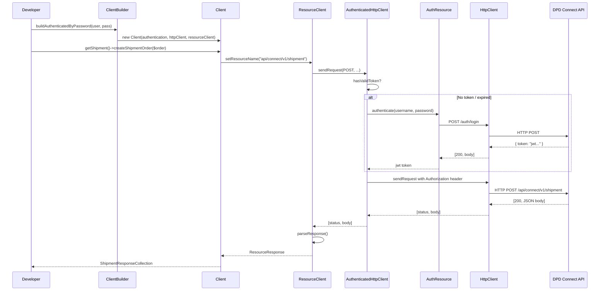

<!--
DOCS_METADATA:
  generated_at: 2026-02-19T12:49:04Z
  git_hash: ad2d32b
  tool_version: 1.0.0
  source_command: /create-documentation
-->

<!-- AUTO-GENERATED:START - Do not edit manually -->

# Architecture

## Overview

The DPD Connect PHP SDK uses the **Builder pattern** to construct a fully wired `Client` instance. Internally it applies a layered HTTP stack, where each layer adds one responsibility (auth, resource mapping, response parsing).

## Package Structure

```
src/
├── Client.php                        # Public entry point — owns all resources
├── ClientBuilder.php                 # Builds and wires the Client
├── ClientBuilderInterface.php
├── CacheWrapper.php                  # Cache abstraction (filesystem or custom)
├── RequestValidator.php
│
├── Api/                              # Interfaces (contracts)
│   ├── ShipmentLabelInterface.php
│   ├── ShipmentOrderInterface.php
│   └── Data/
│       ├── Response/                 # Response data contracts
│       └── ShipmentOrder/           # Shipment data contracts
│
├── Common/                           # Core HTTP infrastructure
│   ├── HttpClient.php                # cURL-based HTTP client
│   ├── HttpClientInterface.php
│   ├── AuthenticatedHttpClient.php   # Injects JWT token into every request
│   ├── Authentication.php            # Holds credentials / JWT token
│   ├── AuthenticationResourceInterface.php
│   ├── ResourceClient.php            # CRUD operations (GET / POST / DELETE)
│   ├── ResourceClientInterface.php
│   └── ResponseError.php             # Parses API validation errors
│
├── Exceptions/                       # Exception hierarchy
│   ├── DpdException.php              # Base SDK exception
│   ├── ApiException.php
│   ├── AuthenticateException.php
│   ├── HttpException.php
│   ├── RequestException.php          # API 4xx validation errors
│   ├── ServerException.php           # API 5xx errors
│   ├── ShipmentStatusException.php
│   ├── ShipmentValidationException.php
│   ├── ValidationException.php
│   └── InvalidResponseException.php
│
├── Model/                            # Data transformation layer
│   ├── Request/RequestMapper.php     # Maps Magento/custom requests → ShipmentOrder objects
│   └── Response/
│       ├── ShipmentResponseParser.php
│       ├── OrderResponseTransformer.php
│       └── ResponseParserInterface.php
│
├── Objects/                          # Domain value objects
│   ├── BaseObject.php                # JsonSerializable base with dynamic properties
│   ├── ObjectFactory.php             # Simple factory: new $class($data)
│   ├── ShipmentOrder.php
│   ├── ShipmentLabel.php
│   ├── ShipmentAsync.php
│   ├── Parcelshop.php
│   ├── MetaData.php
│   ├── ResourceResponse.php
│   └── ShipmentOrder/
│       ├── Contact/                  # Address, Sender, Receiver
│       ├── Customs/                  # Consignee, Consignor, CustomsLine
│       ├── Shipment/                 # CashOnDelivery, Customs, Notification, Parcel, Pickup, Product
│       └── PrintOptions.php
│
├── Resources/                        # API resource classes (thin wrappers)
│   ├── BaseResource.php
│   ├── Authentication.php
│   ├── Shipment.php
│   ├── Parcelshop.php
│   ├── Country.php
│   ├── Parcel.php
│   ├── Product.php
│   ├── Job.php
│   ├── Token.php
│   ├── CacheInterface.php
│   └── CacheableInterface.php
│
└── Util/
    ├── StreetSplitter.php            # Splits full street into street + housenumber
    └── StreetSplitterInterface.php
```

## Class Responsibilities

### `ClientBuilder` (`src/ClientBuilder.php`)

Entry point for SDK consumers. Responsible for wiring all dependencies:

1. Creates `HttpClient` (cURL transport)
2. Creates `Authentication` value object
3. Creates `AuthenticationResource` (calls `/auth/login`)
4. Creates `AuthenticatedHttpClient` (wraps HttpClient, injects Bearer token)
5. Creates `ResourceClient` (wraps AuthenticatedHttpClient, handles CRUD)
6. Creates `Client` with all resource instances

### `Client` (`src/Client.php`)

Facade that exposes resource objects. All `get*()` methods return a resource instance.

### HTTP Stack (layered)

```
ResourceClient
  └── AuthenticatedHttpClient
        └── HttpClient  (cURL)
```

| Layer | File | Responsibility |
|-------|------|---------------|
| `HttpClient` | `Common/HttpClient.php` | Raw cURL, builds URL, sets headers, handles HTTP errors (401 → `AuthenticateException`, 500 → `ServerException`) |
| `AuthenticatedHttpClient` | `Common/AuthenticatedHttpClient.php` | Fetches/refreshes JWT token, injects `Authorization: Bearer` header |
| `ResourceClient` | `Common/ResourceClient.php` | GET/POST/DELETE abstraction, JSON serialisation, response parsing (`RequestException` on 4xx) |

### `BaseObject` (`src/Objects/BaseObject.php`)

All domain objects extend `BaseObject`. It implements `JsonSerializable` and uses a `$dynamicProperties` array to support both typed and untyped fields. The `__call` and `__get` magic methods transparently proxy to defined properties or the dynamic bag.

```php
class ShipmentOrder extends BaseObject
{
    protected $printOptions;
    protected $createLabel;
    protected $shipments;
}
```

Serialisation (`jsonSerialize`) returns only non-null `$dynamicProperties` values, which ensures clean JSON payloads to the API.

## Request / Response Flow



## Design Patterns Used

| Pattern | Where |
|---------|-------|
| Builder | `ClientBuilder` constructs `Client` |
| Factory | `ObjectFactory::create($class, $data)` |
| Facade | `Client` hides internal wiring |
| Decorator | `AuthenticatedHttpClient` wraps `HttpClient` |
| Template Method | `BaseResource` defines resource structure |
| Value Object | All `Objects/` classes |

## API Endpoints Summary

| Resource | Endpoint | Methods |
|----------|----------|---------|
| Authentication | `POST /auth/login` | Login |
| Shipment (sync) | `POST /api/connect/v1/shipment` | Create |
| Shipment (async) | `POST /api/connect/v1/shipment/async` | Create |
| Parcelshop list | `GET /api/connect/v1/parcelshop` | List |
| Parcelshop by ID | `GET /api/connect/v1/parcelshop/{id}` | Get |
| Countries | `GET /api/connect/v1/countries` | List |
| Parcel status | `GET /api/connect/v1/parcel/status/{id}` | Get |
| Parcel label | `GET /api/connect/v1/parcel/label/{id}` | Get |
| Products | `GET /api/connect/v1/available-products` | List |
| Job state | `GET /api/connect/v1/job/{id}` | Get |

<!-- AUTO-GENERATED:END -->

<!-- MANUAL:START - Safe to edit, preserved on updates -->
<!-- Add custom notes, team-specific information, or project-specific details below -->
<!-- MANUAL:END -->
